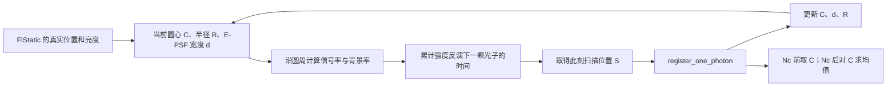

# Bayesian MINFLUX 精读与当前 MINSTED 仿真对应

阅读日期：2026-10-16。初次精读时只新增阅读笔记，未修改仿真源码。

后续更新：按用户要求，已将 `get_effective_psf_coefficient` 改为调用与 `signal_rate` 相同的高斯 E-PSF，原先的激发/损耗公式已移除。`test3.py` 与 notebook 通过原接口自动使用统一模型，`d_i` 均表示实际 FWHM。时间步与事件驱动采样方式仍各自保留。下文关于两套模型及 12.943 nm 宽度的分析、旧版 `test3` 运行数据记录的是统一前的版本，用作问题溯源；其他问题不因此自动解决。原有未提交修改已保留。

贝叶斯原型更新：已另行新增 `BayesianMinstedSimulator` 与对比示例，参见 [实现说明](bayesian_minsted.md)。下文“没有位置后验”等描述针对原有 `MinstedSimulator`，不包括这个新模块。

连续圆周验证更新：已实现保留连续扫描的后验推断与首到达 EIG 控制，并完成 200 组配对试验，见 [验证结果](circular_bayesian_results.md)。

## 1. 核心判断

这篇论文把定位看成一个闭环的序贯实验设计问题：维护完整的位置后验分布，再选择下一次最有信息的照明位置。其贡献同时涉及估计器和扫描策略。

当前仓库实现的则是 MINSTED 的圆周扫描反馈：每次探测到光子，把扫描圆心向该光子的扫描位置移动一小步，并逐步缩小 E-PSF 和扫描半径；最后对小尺度阶段的圆心求均值。它没有位置后验，也没有预期信息增益优化。

论文思想可以用于 MINSTED，但必须使用 MINSTED 的发光率构造似然。不能把 MINFLUX 的甜甜圈激发强度直接替换进当前高斯 E-PSF，然后把结果当作同一种显微方法的算法改进。

## 2. 来源与阅读边界

- Schultze, S.; Grubmüller, H. *Bayesian MINFLUX Localization Microscopy*. ACS Photonics **2026**, 13, 833–837。使用用户提供的正式发表版 PDF，完整阅读 5 页，并查看所有图和公式的页面渲染。[出版社入口](https://pubs.acs.org/doi/abs/10.1021/acsphotonics.5c02739)。本地文件：`C:/Users/20291/Zotero/storage/WEY3Y3KY/bayesian-minflux-localization-microscopy.pdf`。
- 当前仓库 `paper/41566_2021_774_MOESM1_ESM.pdf`：2021 年 MINSTED 补充材料，重点核对补充正文 pp. 1–4，即 PDF pp. 2–5，特别是 S1、S3–S7、S10。
- 工作区源码以当前磁盘内容为准，重点覆盖模拟器、四个 Python 示例、旧 notebook、分子模型及相关工具。
- 作者 [GitLab 项目入口](https://gitlab.gwdg.de/sschult/minflux) 与论文引用的 [Zenodo 记录](https://doi.org/10.5281/zenodo.17482048) 可供后续复现使用。本次未成功读取作者 Julia 源码，因此以下不对其内部实现作未经核实的断言。
- PDF 内容按研究资料处理，没有将其中的文字当作修改工作区的指令。

## 3. 贝叶斯 MINFLUX 的数学主线

### 3.1 首先区分三种“位置”

论文中：`x` 是待估计分子位置，`x0` 是仿真真实位置，`r_k` 是第 k 次曝光的照明强度最低点。`r_k` 是实验控制量，不是位置估计本身。

为避免原文符号复用，下面用 `s` 表示甜甜圈光斑的固定尺度，约 200 nm，用 `u` 表示后验分布宽度。它们不是同一个量。

式 (1) 可以写成：

\[
q(\mathbf x;\mathbf r)
= e(1-b)\frac{\|\mathbf x-\mathbf r\|^2}{s^2}
  \exp\left[-\frac{\|\mathbf x-\mathbf r\|^2}{s^2}\right]+b,
\qquad I(\mathbf x;\mathbf r,\eta)=\eta q(\mathbf x;\mathbf r).
\]

在距离 `s` 处，`q=1`；在零点处，`q=b`。这里的 `I` 直接作为一次曝光的期望光子数进入泊松分布，不能与工作区单位为 kHz 的 `signal_rate` 不加换算地混用。

`b` 是相对于甜甜圈峰值的强度底，并与整体因子 `eta` 一起缩放。它不等于工作区固定的背景计数率 `bg_global`。`b=0.01` 也不能简单解释成任意位置的 SBR 都是 100：局部信号还取决于分子到强度零点的距离。

### 3.2 一次曝光就是一次贝叶斯更新

对第 k 次曝光：

\[
n_k\sim\mathrm{Poisson}\big(I(\mathbf x_0;\mathbf r_k,\eta_k)\big),
\]

\[
P_k(\mathbf x)=
\frac{P_{k-1}(\mathbf x)e^{-I_k(\mathbf x)}I_k(\mathbf x)^{n_k}/n_k!}
{\int P_{k-1}(\mathbf z)e^{-I_k(\mathbf z)}I_k(\mathbf z)^{n_k}/n_k!\,d\mathbf z}.
\]

这个更新保留以前全部曝光的证据，包括可能的偏斜、环状和多峰结构。仅保留 MAP 或均值会丢失这些结构。

特别是 `n_k=0` 时：

\[
P_k(\mathbf x)\propto e^{-I_k(\mathbf x)}P_{k-1}(\mathbf x).
\]

没有光子意味着“那些本来应该很亮的位置变得不太可信”。在 MINFLUX 中，这往往提升强度最低点附近的位置概率；在高斯 E-PSF 的 MINSTED 中，则往往压低高发光率区域的位置概率。相同的贝叶斯规则，因发光模型不同而有不同的空间解释。

### 3.3 为什么要让各候选位置拥有相同的期望光子数

如果某个位置仅仅因为照得更亮而给出更多光子，它可能有更高的单次曝光信息量，但每个光子的效率未必更高。

论文式 (4) 对每个候选位置重新设置：

\[
\eta(\mathbf r)=\frac{\mu}{\int P_{k-1}(\mathbf x)q(\mathbf x;\mathbf r)\,d\mathbf x},
\]

使先验预测的期望计数恰好等于 `mu`。

这是对当前后验平均的期望，不是保证真实位置在这次曝光恰好产生 `mu` 个光子。`mu` 也不是一个指定“必须收齐”的光子阈值。比较的是每次曝光相同的预测光子成本。

`mu` 小时常有零光子曝光，光子利用效率高，但曝光次数可能增加。`mu` 较大时每次曝光可能提供更多信息，曝光步数可减少。这是两个不同的资源目标。由于论文没有完整约束强度、驻留时间、硬件切换和光漂白，曝光次数不能直接等同于实际耗时或光损伤。

### 3.4 预期信息增益 EIG 实际在优化什么

先用当前后验得到候选曝光的预测分布：

\[
p(n\mid\mathbf r)=\int P_{k-1}(\mathbf x)
\mathrm{Pois}\left(n\mid I(\mathbf x;\mathbf r,\eta(\mathbf r))\right)d\mathbf x.
\]

采用标准 Shannon 熵 `H(P)=-integral P log(P)`：

\[
\mathrm{EIG}(\mathbf r)=H(P_{k-1})-
\sum_{n=0}^{\infty}p(n\mid\mathbf r)H(P_k(\cdot\mid n,\mathbf r)),
\qquad \mathbf r_k=\arg\max_{\mathbf r}\mathrm{EIG}(\mathbf r).
\]

也就是在采样之前，枚举可能的计数结果，评价这些结果平均能减少多少位置不确定性。它不是“选择最可能出光子的位置”，也不是每次都把零点放在 MAP 上。

实现时更稳妥的等价式是：

\[
\mathrm{EIG}(\mathbf r)=
\sum_n\int P_{k-1}(\mathbf x)p(n\mid\mathbf x,\mathbf r)
\log\frac{p(n\mid\mathbf x,\mathbf r)}{p(n\mid\mathbf r)}\,d\mathbf x.
\]

这是位置和下一次计数之间的互信息，理论上非负。数值实现应处理 `0 log 0`、泊松尾部截断和对数下溢。

**原文符号问题：**PDF p. 2 对 `S(P)` 的定义印成了 `integral P log(P)`，没有负号，但式 (5) 和正文使用的是熵下降的方向。两者按字面不一致。复现时应采用标准负号定义，或直接采用上述互信息式；不能把这个符号问题带进优化器。本次未核查作者源码怎样处理此处。

### 3.5 “最优”的适用范围

严格说是：给定似然、当前后验和论文的曝光归一化方式，使**下一步**期望信息增益最大。它不是对所有后续曝光、总时间和光损伤的全局最优保证，也不保证实际遇到的每一次计数都会降低后验熵。

论文自己指出，多步规划还有改进余地；初步两步 EIG 测试报告约 10% 的额外光子数减少，代价是更高计算量。

## 4. 五张图怎样读

| 图 | 展示内容 | 需要带走的结论 |
|---|---|---|
| Fig. 1 | 后验、实际计数的似然、下一步 EIG；`mu=2` | 后验不必是单峰高斯；零光子也改变后验；红色零点位置由实验设计选择。 |
| Fig. 2 | MAP 和照明零点随曝光移动；`mu=0.5` | 控制位置与估计位置是两条不同轨迹；其径向坐标在 1 nm 以下线性、以上对数，不能按普通欧氏平面理解图上距离。 |
| Fig. 3 | 对累计光子数、曝光次数分别比较精度；实线完整 EIG，虚线近似策略 | 光子效率和曝光效率应分别评价；约 120 对约 500 光子的结果来自特定仿真基线。 |
| Fig. 4 | 高斯后验下 EIG 的径向分布与最优偏置距离 `D(u)` | 宽后验时甜甜圈外侧斜坡可能更有信息；窄后验时零点靠近分子，但背景使最佳偏移保留有限值；`D(u)` 不是处处平滑、单调的缩小律。 |
| Fig. 5 | 改变强度底 `b` 后的效率 | 背景越高越需要光子；背景主导后指数式改善转向约 `N^-1/2`。它不是不受背景影响的算法。 |

Fig. 3 的关键实验条件：每个设置 1000 次模拟，初始二维高斯先验单轴标准差 150 nm，真实分子位置从该先验抽取，主要结果用 `b=0.01`。传统 MINFLUX 基线为六角扫描，三阶段直径 200、150、40 nm，前两阶段光子数分别为 40 和 90，第三阶段光子数变化。

论文纵轴统计量是各次运行

\[
e_{1D}=\frac{\|\mathbf x_{MAP}-\mathbf x_0\|}{\sqrt 2}
\]

的中位数。它不是后验标准差、不是跨实验单轴标准差，也不是 RMSE。约四倍改进对应这套模拟和这套基线；论文没有直接给出对当前 MINSTED 代码的四倍改进证据。

### 快速近似策略与数值实现

式 (9) 用

\[
\mathbf r_k=\mathbf x_{MAP,k-1}+\mathbf v_kD(\mathrm{std}(P_{k-1}))
\]

代替每步完整优化；`v_k` 为各向同性随机单位向量，`D` 由高斯后验场景预先求得。**后验更新仍然完整执行**，只简化照明位置选择。原文明确将它与 MINSTED 的扫描思想联系起来。

方法部分采用二维网格：初始 60×60，间距 15 nm；更新后按后验宽度细化，间距不大于后验标准差的 1/10；新点线性插值；裁掉整行/列最大概率小于 `10^-9` 的边缘；计数求和截断在 `max(5, mu+50 sqrt(mu))`；位置优化用 L-BFGS。作者报告 `mu=1` 时近似版本一次模拟运行约 4 ms，这属于其 CPU 实现的计算基准，不是你的 Python 仿真耗时或实验采集时间。

研究边界还包括：亮度及光强形状被视为已知，未实现未知亮度/背景的联合推断；没有完整的运动、闪烁、漂白模型。正文讨论了这些扩展，但不能当作已经验证的结果。

## 5. 当前 MINSTED 的实际执行链



光子生成和反馈是两个层次：`MinstedSimulator` 提供扫描几何、发光率和反馈规则；`sample_next_photon` 实际写在示例里。主类本身没有完整的运行循环。

### 5.1 扫描位置：`MinstedSimulator.py:86`

\[
\mathbf S_i(t)=\mathbf C_{i-1}+R_{i-1}
\begin{bmatrix}\cos(-2\pi ft)\\\sin(-2\pi ft)\end{bmatrix}.
\]

这对应 MINSTED 补充式 S6。`time_ms` 是毫秒，所以 `f_scan=125` 实际为 125 圈/ms，即 125 kHz，周期 0.008 ms = 8 微秒；与补充材料的 125 kHz 一致。负号表示顺时针扫描。

### 5.2 主发光模型：`MinstedSimulator.py:96–107`

\[
h_i(\mathbf x,\mathbf S)=
\exp\left[-4\ln2\frac{\|\mathbf x-\mathbf S\|^2}{d_i^2}\right],
\qquad \lambda(t\mid\mathbf x)=\epsilon h_i(\mathbf x,\mathbf S_i(t))+\beta(\mathbf S_i(t)).
\]

这里 `d_i` 是 FWHM，`epsilon` 对应 `brightness`，`beta` 对应 `background_rate`；计数率单位为 kHz = photons/ms。这正是补充式 S5 的近似模型，物理背景是时间门控脉冲 STED 的有效 PSF，不是数值求解矢量衍射场。

`bg_map_func(x,y)` 当前接受的是**扫描位置**，不是候选分子位置。没有该函数时背景率为常数 `bg_global`。

### 5.3 光子时间采样：`examples/test1.py:22`，`test2.py:23`，`test4.py:244`

抽取 `E ~ Exp(1)`，求下一个时间使

\[
\int_{t_{i-1}}^{t_i}\lambda(t\mid\mathbf x_0)dt=E.
\]

这是非齐次泊松过程的累计强度反演，对应补充式 S7。代码先对一个扫描周期用梯形积分，再跳过整圈并在线性插值下反演剩余积分。对于当前静止分子、固定亮度、两次事件之间不变的扫描参数，这是合理的数值实现，误差受相位离散和插值控制。

`origin` 依据事件时刻的信号/总率抽样，仅供仿真统计；真实探测器通常不知道每个光子的来源。

### 5.4 每光子反馈：`MinstedSimulator.py:119`

\[
\mathbf C_i=(1-\alpha)\mathbf C_{i-1}+\alpha\mathbf S_i,
\qquad d_i=\max(\gamma d_{i-1},d_{min}).
\]

由于 `S_i-C_(i-1)` 是扫描半径向量，圆心步长是 `alpha R_(i-1)`。不是对分子真实位置做插值，也不是贝叶斯或最大似然更新。离分子更近的扫描方位产生更多信号光子，因此统计上把圆心拉向分子。

所有探测光子都触发反馈，包括背景。`origin` 在 `register_one_photon` 中没有被使用，这与探测器不知道光子来源相容；不能据此把背景光子事后剔除来获得理想化定位结果。

`I_i=min((d0/d_i)^2-1, imax)` 是随宽度更新的无量纲强度参数。主高斯发光率直接使用 `d_i`，没有通过 `I_i` 再次计算宽度。

### 5.5 输出估计与轨迹：`MinstedSimulator.py:130–157`

\[
\widehat{\mathbf x}(N)=
\begin{cases}
\mathbf C_N,&N\le N_c,\\
\frac{1}{N-N_c+1}\sum_{i=N_c}^{N}\mathbf C_i,&N>N_c.
\end{cases}
\]

对应补充式 S1；第 `Nc` 个圆心也包含在平均中。在 `N=Nc` 时两种定义结果相同。

- `get_center_history()`：原始圆心 `C_i`，有持续反馈抖动。
- `get_history()`：最终位置估计的历史，缩小结束后是累计均值。
- `get_localization_estimate()`：当前最终估计。

连续的 `C_i` 彼此相关。单条圆心轨迹的标准差不能直接当作最终定位精度；也不能直接除以光子数平方根并假定独立。`test2` 的连续分组子采样正是在处理这件事，对应补充式 S3、S4。

## 6. 各文件在项目中承担什么角色

| 文件/模块 | 当前作用与适用边界 |
|---|---|
| `simulators/MinstedSimulator.py` | 二维扫描状态、两套发光模型、逐光子反馈、最终均值估计。 |
| `examples/test1.py` | 主高斯模型下的一次事件驱动定位，绘制圆心、到达时间；实际用于位置图的是 `get_center_history()`。 |
| `examples/test2.py` | 重复定位；计算 RMSE、std、bias；按中位误差筛选；估计单轨迹分组精度；光子总预算从人为给定的截断对数正态分布抽样，并非实际漂白产生。 |
| `examples/test3.py` | 固定 0.001 ms 时间步，调用另一套激发/损耗模型，再对时间箱内光子数作泊松采样。 |
| `examples/test4.py` | Fig. 2 风格统计；a 为固定扫描 Fisher 信息，b 为固定 d 的中心分布 Monte Carlo，c 为缩小扫描的相位采样和长光子数外推。没有执行贝叶斯更新。 |
| `examples/test1.ipynb` | 较旧的时间步示例；`dt=0.05 ms` 超过一个扫描周期；记录数组没有在循环中填充，按当前内容不能当作可靠基准。 |
| `Fluorophore` / `FlStatic` | 位置、亮度、强度/泊松计数接口；静止分子是当前主要运行路径。 |
| `FlMoving` / `FlBleach` / `FlBlinkBleach` / `FlMoveBleach` | 运动、预算漂白、闪烁和组合能力；是否真的生效取决于运行循环调用了哪些方法。 |
| `FlCollection` / `FlCollectionBlinking` | 多分子容器及开关状态；当前示例并没有接入多分子总发光率。 |
| `utils/FluorescentMolecule.py` | 另一套二维扩散及 ON/OFF/BLEACHED 状态机，未接入当前四个 Python 示例。 |
| `utils/H5_reader.py`、`SurfFit.py`、`drift.py` | 实测 HDF5 数据读取、PSF/LPM 多项式拟合、漂移修正；不在当前模拟光子反馈链中。 |
| `tools/` | 字段合并、核孔结构生成、显示等辅助函数；不是位置后验或扫描优化器。 |

## 7. 已确认的差异与实现问题

以下属于当前代码行为和文献核对结果；本次没有据此直接改代码。

### A. 两套 E-PSF 不能作为同一模型混合比较

`epsf_from_distance_sq` 给出的高斯 FWHM 明确等于 `d_i`。但 `get_effective_psf_coefficient` 用的是：

\[
\frac{\exp[-4\ln2\,r^2/d_0^2]}{1+I_i r^2/d_i^2}.
\]

它采用激发高斯乘以稳态式抑制因子，本身不能从“严格物理叠加”的注释推导出与脉冲/门控 MINSTED 模型一致的结论。`I_i` 已由 `d_i` 计算，而分母再次用 `d_i` 设尺度，最后的 FWHM 并不等于 `d_i`。

数值核查：`d0=250 nm`，`d_i=40 nm`，`I_i=38.0625` 时，这套函数的 FWHM 约为 **12.943 nm**。所以 `test3` 与 `test1/2` 即使填相同 `d_min=40`，也不是相同空间响应宽度。`self.w_ex` 在这里也没有被使用，而是由 `d0` 重新算了一个局部变量。

### B. 半径和 PSF 的下限处理不同步

`R_i` 的更新放在 `if d_i > d_min` 里面。`d` 到底后，半径也停止减小，即使还没有达到 `r_min`。

对示例参数 `d0=250, d_min=40, gamma=.97, r_d=.5, r_min=5`：

\[
N_c=\left\lceil\frac{\log(40/250)}{\log .97}\right\rceil=61.
\]

最后 `d=40`，而 `R=125*.97^61≈19.4978 nm`，不会达到 `r_min=5 nm`。最后一步 `d` 被夹到 40，但 `R` 继续乘 .97，因此 `R/d` 也不是精确的 .5。若想严格绑定 `R=r_d*d`，或让两者各自减至下限，需要明确选择一种规则。

### C. `Nc` 有两种语境

主类的 `Nc` 是到达 `d_min` 的光子编号，在固定参数下是确定的，不是实际后验收敛或成功定位的判断。

`test4` 图 b 的 `convergence_nc_from_static_mc` 则估算固定 d 时圆心分布接近稳态所需的检测数，是另一种统计定义。它用末段平均宽度、8% 容差和连续窗口判据，属于实现中的近似规则。二者不应直接相互替代。

### D. `test4` 图 c 部分曲线是外推

默认最大展示 10000 光子，但仅直接模拟到 1200；之后按 `sqrt((1200-Nc+1)/(N-Nc+1))` 外推。由此得到的长尾不能用来证明仿真自然出现了 `N^-1/2` 标度。

图 c 的相位抽样与事件时间反演也不同：其相位权重正比于一圈内的计数率，没有显式到达时间，适用于相位平均/快速扫描近似，不能拿来研究时间分辨率、闪烁或运动。在中心恰好对准且固定扫描的条件下计算的 Fisher 界，也不能自动代表具有初始化误差、自适应过程和失败轨迹的完整估计器性能。

### E. 相机参考公式有括号错误

`examples/test4.py:433` 中：

```python
np.sqrt(2.12 / sbr + 4.24)
```

与补充式 S10 不一致。S10 对应：

```python
np.sqrt(2.12 / (sbr + 4.24))
```

其余因子保留时，SBR=10 的当前背景放大系数约 2.136，S10 为 1.529。当前有限 SBR 公式在 SBR 趋于无穷时还趋近约 1.749，而代码的 `np.inf` 分支为 1，产生不连续。默认图 c 用无背景参考，所以默认这条黑线未受有限 SBR 分支影响。

### F. 误差筛选与统计量必须一起报告

`test2` 和 `test4` 使用“径向误差不超过中位径向误差 5 倍”的真值筛选。这种仿真筛选有 MINSTED 补充材料依据，但筛选后的精度表示保留样本的条件性能。

目前 `test2` 对每个 N 重新筛选；与文献描述的失败后对余下 N 持续排除，并非完全相同。应用时应同时报告全样本指标、失败/排除比例和保留样本指标。`test2` 图 c 采用真实径向误差替代实验中估计的不确定性，也不能直接解释成实验的定位精度分布。

另外，`test2` 子采样拟合后把负参数分别截断为 0，并不等价于重新求解非负约束最小二乘；这会影响个别轨迹的精度外推。

### G. 事件采样器尚未支持完整运动和光物理

`sample_next_photon` 在上次事件时刻取得分子位置，整圈及跨圈积分都假定其位置和亮度不变；到新事件时刻再取位置，并不能补回积分期间的运动。因此不能仅把 `FlStatic` 换成 `FlMoving` 就认为得到了正确的运动分子泊松采样。

同样，当前事件驱动路径直接访问 `fl.brightness`，没有通过 `FlBleach.intensity` 消耗预算，也没有积分 ON/OFF 状态；检查 `remainingphotons` 本身不会使其减少。`n_on` 虽然保存在模拟器里，但没有实现搜索激活阶段；也没有文献的 `n_off/tau_off` 终止检测。

`FlMoving.makediffusion` 的 `dt` 注释写 us，扩散换算 `D*1000` 却对应 `nm^2/ms`；接入时必须统一时间单位。若按 us 传入并把结果视为物理微秒，单步方差会多 1000 倍。当前静态示例未受此问题影响。

### H. 固定时间步内多光子反馈有离散误差

`test3` 一个时间箱内所有光子都使用同一个 `s_i_snap`；但注册第一颗之后圆心和宽度已经改变。亮度峰值 1000 kHz 与 `dt=.001 ms` 对应峰值每箱约 1 个信号光子，因此多光子箱并不能一概忽略。要复现真正的逐事件反馈，应对到达时间逐个采样，或检验时间步足够小后的收敛性。

### I. 光学与 GPU 参数不等于已实现对应物理

`wl_ex`、`wl_sted`、`na`、`n_media`、`pupil_res`、`zernike_coeffs` 目前仅存储，没有参与当前空间响应的计算。`torch` 仅用于选择设备，没有参与定位数值计算。因此当前是简化的二维反馈统计仿真，不能从这些构造参数推断其已经包含像差、矢量光学或 GPU 加速。

## 8. 本次数值核查

使用现有 Conda 环境 `C:/Users/20291/miniconda3/envs/minsted/python.exe`。从 `test1` 提取原有光子采样函数运行，未导入并执行其绘图主程序。参数沿用示例：真实位置 `[10,0] nm`，初始中心各轴 `N(0,60^2)`，亮度 30 kHz，背景 3 kHz，`d0=250, d_min=40, r_min=5, alpha=.15, gamma=.97, r_d=.5, f_scan=125`。随机种子 `20261016`，100 次重复，每次 300 光子，相位离散数 120。

| 指标 | 数值 |
|---|---:|
| `Nc` | 全部为 61 |
| 每次参与后期平均的圆心数 | 240 |
| 最终 `R` | 19.4978 nm |
| 平均背景光子占比 | 16.693% |
| 总采集时间的中位数 | 16.684 ms |
| 全部 100 次的等效单轴标准差 | 2.331 nm |
| 全部 100 次的等效单轴 RMSE | 2.324 nm |
| 全部 100 次的中位径向误差 | 1.657 nm |
| 以 5 倍中位误差筛选后保留数 | 99 |
| 保留样本的等效单轴标准差 | 1.504 nm |
| 最大径向误差 | 25.164 nm |

本表标准差定义为 `sqrt((var_x+var_y)/2)`，样本方差用 `ddof=1`；RMSE 为 `sqrt(mean((dx^2+dy^2)/2))`。论文的中位 `e_1D` 若在这批样本上计算，应为 `1.657/sqrt(2)≈1.171 nm`，它和表中的 2.331 nm 不是同一指标。

这是核查实现行为的小规模实验，不是收敛研究、论文复现或算法排名。100 次样本不足以精确估计尾部失败率。此次没有进行相位网格收敛性扫描。

还核对了：最终估计等于 `get_center_history()[Nc:]` 的均值；更换同一事件的 `origin` 标签不改变反馈；全部仓库 Python 源文件可通过语法解析。另对 `test3` 进行无界面运行检查，3000 步、3 ms 共生成 329 个光子，最终估计约 `[9.630,1.097] nm`；这仅说明该路径可运行，不证明它的物理模型与高斯路径一致。

## 9. 将贝叶斯思想用于当前 MINSTED 的具体途径

### 第一步：保留扫描反馈，单独增加位置后验

先沿用当前 `C,d,R` 控制律，用同一批光子记录同时计算旧估计与贝叶斯估计，才容易区分估计器与扫描策略各自带来的收益。

至少记录事件时间、扫描位置，以及事件前的 `C,d,R`。对于事件驱动模型，完整似然是非齐次泊松点过程：

\[
\mathcal L(\mathbf x;[0,T])=
\exp\left[-\int_0^T\lambda(t\mid\mathbf x)dt\right]
\prod_{i=1}^{N(T)}\lambda(t_i\mid\mathbf x).
\]

其中扫描路径使用实际已执行的自适应控制记录。只乘事件处的高斯值会丢掉等待时间信息，也会漏掉背景混合和无光子区间，通常不是该实验的完整似然。

相邻事件间可递推：

\[
\log P_i(\mathbf x)=\log P_{i-1}(\mathbf x)
+\log\lambda(t_i\mid\mathbf x)
-\int_{t_{i-1}}^{t_i}\lambda(t\mid\mathbf x)dt
-\log Z_i.
\]

式中最后一项完成归一化。实验结束到 `T` 的剩余无事件区间也应计入。仿真的 `origin` 不应交给估计器。

另一种实验定义是固定时间曝光，使用 `n_k~Pois(Lambda_k(x))`；此时 `Lambda_k(x)=integral lambda(t|x)dt`，零光子箱自然进入更新。这两种记录方式都可用，但其采样模型和似然必须匹配。

### 第二步：让扫描策略使用后验

在统一 MINSTED 发光模型下，比较固定反馈、依据后验尺度选半径、候选角度/半径的 EIG 优化。可先优化圆心和扫描半径中的少数变量，再考虑更自由的照明位置。

不能直接照搬 MINFLUX 的 `D(u)` 查表；该表依赖甜甜圈激发形状、背景和曝光设置。用于 MINSTED 时，需要针对当前高斯 E-PSF 及可控 `d` 重新求解。

改变 STED 功率、改变激发功率和改变曝光时间，对信号、背景及光漂白的作用不同。真实硬件模型中应显式定义哪些背景随激发缩放、哪些固定，再加入可用功率、最小驻留时间、反馈延迟等限制。

### 第三步：公平评价

用相同真实位置分布、初始信息、发光模型和背景，分别比较：旧估计/旧扫描、贝叶斯估计/旧扫描、贝叶斯估计/自适应扫描。共同报告全样本 RMSE、中位 `e_1D`、偏差、保留样本精度、失败比例、累计检测光子、采集时间和计算时间；后验可信区间还应检查覆盖率。

如果目标是运动跟踪，需要在观测更新前加入运动转移模型；对静态分子做累计后验和对运动分子做滤波是不同任务。当前 `Nc` 后永久累计均值适合静态定位，长期使用会对运动产生滞后。
